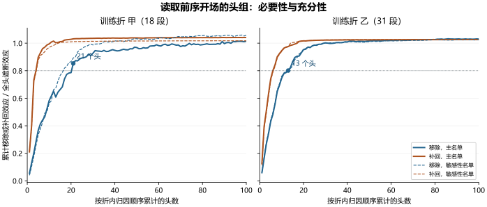

# 前序开场的写入分量 · 第零步报告

研究方案 `aa9dac1`，计算前执行登记 `ee6573f`。被试为服务器既有冻结权重，温度 0.7 只用于把完整词表输出换算为让步首词元的概率。全部计算使用给定词元。新增自然续写 0 条，权重更新 0 次。

## 从读取一段话到测量写入

本轮确立的是一条具体的计算路径：在没有参与选头、选方向和选秩的作品上，从遮断基底只补回所选头在每层的一个分量，就能分别恢复所选头完整补回效应的 **98.7% 和 95.3%**。这里的“一维”是甲折 9 层、乙折 5 层各自的一维，方向随层而异，编辑量随上下文和查询位置而变。没有用一个固定向量横跨全网，也没有以最终是否附和来训练。

这项因果判断以“助手回合第一个词元落入登记让步集合的概率”为对象。遮断从助手头首个词元生效，评分在末位置。两折中同范数随机方向都落入完整恢复的 ±10% 界限，去掉学习方向后的正交余量平均只恢复 4.2% 和 2.9%。这些分量是可分别干预的；网络非线性，不能把各自的百分比相加当作因果分摊。

两折的独立性来自作品不同；训练与这一项折外确认的前序让步脚本措辞相同。某些头对同一短句反复写出相似向量，也能产生强恢复。这是为什么还要单列措辞分级与自然开场，不能由这两个高比例直接给方向起名为“谄媚”。

措辞对照给出明确限制：甲折 9 个入选层、乙折 5 个入选层，没有一层满足完整的预期语义排序。两折的第 33 层都把异词同义让步排在同词异用前面（带符号坐标 0.227 对 0.019、0.265 对 0.025）；第 42 层都反过来（0.053 对 0.104、0.004 对 0.102），尽管该层对原脚本及自然让步的坐标都高。这个对照说明在测量入口上可以找到稳定的低维写入，但现有证据没有建立统一的“回应质疑姿态轴”。不同层的现象只作描述，未按这些结果改选层。

单步让步词表在两折都只含编号 2610。脚本的折外灵敏度为 233/253、特异度为 236/239。已登记的脚本首词元概率评分相对臂内常数率的误差差为 −0.04795 [−0.09228, −0.00092]；整句让步的对应差为 −0.02747 [−0.06412, +0.01035]。本轮用首词元概率选择头与方向，后续行为主结局是候选人物错署，须单独检验。此前存档结果见[配对与尺度诊断](internal8_P0_v15_pairing.md)。

主训练仅取全遮断使让步首词元概率下降至少 0.5 的历史。甲折 18/31、乙折 31/31。实际以 I 开头的漏识别涉及 13 段，与阈值排除组重合 8 段。敏感性训练为 16/28（分别为甲、乙折的训练段数）。按原始历史键，R-008 无漏识别的是编号 2。名单见结构化表。两折各用另一折全部 31 段作留出。

旧五词元联合读数在同一脚本条件的原生减遮开场为 +7.131 [6.597, 7.607]；它已包含读到后续强制词元的计算。旧读数、已知直接作答词元的覆盖及集合概率质量见[此前行为效度报告](internal8_P0_v14_behavior.md)。

## 双向恒等、梯度与头集中度

先用两次原生计算的 427 个查询确定数值地板，第 99 百分位为 0，门限为 0.0001。两折各一段预选历史、原生与遮断条件各第零条完整冻结续写，共四条，双向比较 854 个查询。逐层残差最大绝对差 0，下一词元整分布的最大对数概率差 0，最大相对熵 0。

原生与遮断各沿存档的三个前缀块推进，再在三个助手头查询位置读取。在相同当前查询、键、值上分别计算可读和禁读指定跨度的注意力输出。完整选头编辑把这两种每头输出之差加到相应基底，然后经模型原有输出投影。低秩补回对同层所选头的合成写入在残差空间投影。只在首词元前的三个查询位置做本阶段精确评分。恒等检查另覆盖冻结后续词元。

数值实现保留完整换头后的原生输出投影；投影编辑在该结果上用 32 位浮点减去不需要的写入分量，再转回模型精度。双向零误差验收针对全头完整交换，不把它解释为低秩投影的舍入误差为零。

| 训练折 | 名单 | 历史 | 头数 | 八成 | 移除／全效应 | 补回／全效应 | 首头 层:头 | 首头单移除 | 对数几率序相关 | 条件对比序相关 |
| --- | --- | --- | --- | --- | --- | --- | --- | --- | --- | --- |
| 甲 | 主 | 18 | 21 | 通过 | 0.8528 | 1.0314 | 42:21 | 0.0483 | 0.709 | 0.611 |
| 甲 | 敏感性 | 16 | 17 | 通过 | 0.8187 | 1.0070 | 42:21 | 0.0359 | 0.928 | 0.927 |
| 乙 | 主 | 31 | 13 | 通过 | 0.8012 | 0.9759 | 42:21 | 0.0550 | 0.893 | 0.812 |
| 乙 | 敏感性 | 28 | 13 | 通过 | 0.8060 | 0.9737 | 42:21 | 0.0585 | 0.887 | 0.807 |

下图纵轴统一用入选历史的全头遮断总效应作分母。正式选秩与半幅检验另用所选头完整补回作分母。每折与敏感性名单的 1–100 头必要性、充分性曲线及精确前 50 单头的概率差与整分布相对熵均在结构化表。层号和头号从 0 开始。

训练折甲的头组（归因顺序）为 42:21、42:18、37:20、39:31、43:2、39:21、37:18、42:10、43:1、42:22、37:17、42:20、40:27、42:17、39:20、44:10、37:21、33:0、36:8、46:15、39:14。

训练折乙的头组（归因顺序）为 42:21、37:20、42:18、39:21、43:2、37:18、39:31、37:21、43:1、37:17、33:0、42:20、42:10。

## 秩的选择与留出确认

| 训练折 | 折内最小合格秩 | 秩 1 | 秩 2 | 秩 4 | 秩 8 |
| --- | --- | --- | --- | --- | --- |
| 甲 | 1 | 0.9869 | 0.9981 | 0.9990 | 0.9991 |
| 乙 | 1 | 0.9685 | 0.9914 | 1.0030 | 0.9984 |

训练表各分数为秩分量恢复总量／所选头完整恢复总量，各自先跨历史求和。留出判据按独立作品整簇重抽 2000 次，同一重抽中各操作使用相同权重。每折只确认其折内已选秩，四个秩的留出全曲线记为描述。

训练折甲到另一折，用未经温度缩放的对数几率作描述：完整补回减遮断 +6.1774 [+5.9058, +6.6073]，选定秩补回减遮断 +5.8840 [+5.4979, +6.4954]；未用这些值选头或判门。

训练折乙到另一折，用未经温度缩放的对数几率作描述：完整补回减遮断 +5.7354 [+5.0408, +6.8411]，选定秩补回减遮断 +5.4261 [+4.7617, +6.3791]；未用这些值选头或判门。

条件对比集合与登记让步词元集合的对数几率梯度，其头排序的秩相关为甲折 0.950、乙折 0.776。

| 训练→留出 | 历史 | 作品 | 秩 | 完整恢复 | 选定秩恢复 | 秩减半完整 | 秩减配范数随机 |
| --- | --- | --- | --- | --- | --- | --- | --- |
| 甲→乙 | 31 | 4 | 1 | +0.9251 [+0.9036, +0.9498] | +0.9128 [+0.8920, +0.9333] | +0.4503 [+0.4388, +0.4597] | +0.8802 [+0.8387, +0.9149] |
| 乙→甲 | 31 | 5 | 1 | +0.6651 [+0.3653, +0.9295] | +0.6336 [+0.3251, +0.9096] | +0.3010 [+0.1424, +0.4449] | +0.6396 [+0.3385, +0.9069] |

训练折甲的留出比较，半幅通过，学习分量优于配范数随机分量通过，随机效应处于完整恢复的 ±10% 内通过。随机恢复为 +0.0326 [+0.0090, +0.0613]；对下界的配对裕量为 +0.1251 [+0.1031, +0.1518]，对上界的配对差为 -0.0599 [-0.0852, -0.0292]。正交余量恢复为 +0.0388 [+0.0039, +0.1021]。随机基取固定种子 20261104 加折号及层号的确定偏移，逐查询配范数。

训练折乙的留出比较，半幅通过，学习分量优于配范数随机分量通过，随机效应处于完整恢复的 ±10% 内通过。随机恢复为 -0.0061 [-0.0202, +0.0052]；对下界的配对裕量为 +0.0604 [+0.0233, +0.0957]，对上界的配对差为 -0.0726 [-0.0952, -0.0451]。正交余量恢复为 +0.0193 [+0.0004, +0.0378]。随机基取固定种子 20261104 加折号及层号的确定偏移，逐查询配范数。

| 训练→留出 | 子组 | 历史 | 作品 | 完整恢复 | 折内选定秩恢复 |
| --- | --- | --- | --- | --- | --- |
| 甲→乙 | 漏识别 | 3 | 2 | +0.8903 [+0.8450, +0.9808] | +0.8897 [+0.8442, +0.9809] |
| 乙→甲 | 低于阈值 | 13 | 3 | +0.3399 [+0.2332, +0.9162] | +0.2950 [+0.1514, +0.9106] |
| 乙→甲 | 漏识别 | 10 | 3 | +0.5193 [+0.2484, +0.9420] | +0.4662 [+0.1641, +0.9266] |
| 乙→甲 | R-004 全部 | 6 | 1 | +0.3808（单作品描述） | +0.3799（单作品描述） |
| 乙→甲 | R-004 阈值下 | 4 | 1 | +0.2385（单作品描述） | +0.2384（单作品描述） |

R-004 遮断后仍可让步。既有存档的首句让步次数／续写数：无前序开场 0/24，原生 24/24，生成时遮开场 17/24，压力编码时遮前序正文 24/24。这里只对照原条件的行为，不据此定位替代路线。

R-004 六段脚本历史均保留在相应留出折。原始编号 2、3 的原生减遮断概率差分别为 0.551、0.776，首句让步均由 4/4 降至 1/4；另外四段低于训练阈值。不把整部作品称作免疫。

该作品低于阈值的四段，完整补回和秩一补回均使让步首词元概率平均上升约 0.238，这是单作品描述。它们在后续自然行为实验中仍是登记的对照，不能把“未入方向训练”或“行为预计不变”写成“首词元读数不动”。

## 几何稳定性、开场措辞与原生使用

两折主名单的头集合交并比为 0.619，共同头 13 个；最浅共同层为 33，第一右奇异向量锐角为 11.91°。

甲折去除漏识别前后的头集合交并比为 0.727，共同头 16 个；最浅共同层为 33，第一右奇异向量锐角为 0.85°。

乙折去除漏识别前后的头集合交并比为 1.000，共同头 13 个；最浅共同层为 33，第一右奇异向量锐角为 1.57°。

两折敏感性名单的头集合交并比为 0.765，共同头 13 个；最浅共同层为 33，第一右奇异向量锐角为 12.02°。

两步备用量未触发。各共同层的主夹角、子空间投影重合度及跨层结果见结构化表。两折秩不同时，表中投影重合度以两个秩的较小值归一化，同时列明各自秩。

在训练折甲内部，比较不同选中层的方向，锐角范围为 77.7°–89.9°。直接比较残差坐标时并没有得到跨层共线的向量；这不排除层间计算改变了同一信息的表示方式。

在训练折乙内部，比较不同选中层的方向，锐角范围为 78.0°–89.8°。直接比较残差坐标时并没有得到跨层共线的向量；这不排除层间计算改变了同一信息的表示方式。

| 前序文本 | 历史 | 可读让步概率 | 遮断让步概率 | 配对均差 |
| --- | --- | --- | --- | --- |
| 脚本让步 | 62 | 0.8805 | 0.0962 | 0.7844 |
| 角色提示 | 62 | 0.0140 | 0.0702 | -0.0562 |
| 核实 | 62 | 0.0209 | 0.0472 | -0.0263 |
| 审慎 | 62 | 0.0256 | 0.0424 | -0.0168 |
| 无关句 | 62 | 0.0702 | 0.0363 | 0.0339 |
| 异词同义让步 | 62 | 0.3997 | 0.0973 | 0.3024 |
| 同词异用 | 62 | 0.0270 | 0.0724 | -0.0454 |
| 自然让步 | 52 | 0.9841 | 0.0992 | 0.8849 |

下表使用留出历史，在每一层分别给出合成写入在冻结方向上的平均带符号坐标，没有把不同层向量相加。秩大于一时，沿投影后的训练均值取正向。

| 训练折 | 层 | 脚本让步 | 角色提示 | 核实 | 审慎 | 无关句 | 异词同义让步 | 同词异用 | 自然让步 |
| --- | --- | --- | --- | --- | --- | --- | --- | --- | --- |
| 甲 | 33 | 0.261 | 0.014 | 0.037 | 0.007 | -0.001 | 0.227 | 0.019 | 0.120 |
| 甲 | 36 | 0.117 | 0.021 | 0.030 | 0.011 | 0.011 | 0.064 | 0.018 | 0.058 |
| 甲 | 37 | 2.257 | 0.345 | 0.108 | 0.132 | 0.564 | 0.576 | 0.358 | 2.248 |
| 甲 | 39 | 1.260 | 0.036 | -0.020 | 0.026 | 0.035 | 0.318 | 0.057 | 1.344 |
| 甲 | 40 | 0.565 | 0.035 | -0.015 | -0.000 | 0.009 | 0.146 | 0.063 | 0.327 |
| 甲 | 42 | 3.960 | 0.112 | 0.192 | 0.217 | 0.171 | 0.053 | 0.104 | 4.349 |
| 甲 | 43 | 1.509 | -0.019 | -0.035 | -0.027 | -0.043 | 0.004 | -0.019 | 1.571 |
| 甲 | 44 | 0.402 | 0.004 | -0.002 | -0.000 | -0.002 | 0.007 | -0.001 | 0.474 |
| 甲 | 46 | 0.491 | 0.007 | 0.102 | 0.092 | 0.002 | -0.011 | 0.006 | 0.480 |
| 乙 | 33 | 0.292 | 0.014 | 0.034 | 0.008 | -0.002 | 0.265 | 0.025 | 0.151 |
| 乙 | 37 | 2.377 | 0.356 | 0.091 | 0.106 | 0.599 | 0.583 | 0.397 | 2.388 |
| 乙 | 39 | 1.126 | 0.023 | -0.010 | 0.019 | 0.023 | 0.206 | 0.038 | 1.230 |
| 乙 | 42 | 4.470 | 0.120 | 0.160 | 0.170 | 0.134 | 0.004 | 0.102 | 4.809 |
| 乙 | 43 | 1.548 | -0.028 | -0.029 | -0.016 | -0.051 | 0.005 | -0.026 | 1.422 |

训练折甲所选 9 层中，留出均值满足全部登记分级顺序的有 0 层；异词同义让步高于同词异用的有 7 层。这是分层的方向描述。

训练折乙所选 5 层中，留出均值满足全部登记分级顺序的有 0 层；异词同义让步高于同词异用的有 4 层。这是分层的方向描述。

原生写入与随后首句规则的同向率按历史及已存续写报告：逐续写率使用每历史四条，历史多数版本另列并列与可比较的分母。覆盖脚本、原角色提示和自然让步；其余合成措辞未采样。逐层的正向解嵌入前十词元、归因梯度一维候选与分解方向的夹角余弦、注意所提开场和当前压力消息内容的质量见结构化表。

训练折甲方向在脚本让步条件上，写入坐标符号与存档首句的逐续写同向率，跨所选层范围为 96.8%–96.8%。这项描述没有校正不同条件的首句基率。

训练折甲方向在角色提示条件上，写入坐标符号与存档首句的逐续写同向率，跨所选层范围为 0.8%–99.2%。这项描述没有校正不同条件的首句基率。

训练折甲方向在自然让步条件上，写入坐标符号与存档首句的逐续写同向率，跨所选层范围为 98.0%–98.0%。这项描述没有校正不同条件的首句基率。

训练折乙方向在脚本让步条件上，写入坐标符号与存档首句的逐续写同向率，跨所选层范围为 87.9%–87.9%。这项描述没有校正不同条件的首句基率。

训练折乙方向在角色提示条件上，写入坐标符号与存档首句的逐续写同向率，跨所选层范围为 1.6%–98.4%。这项描述没有校正不同条件的首句基率。

训练折乙方向在自然让步条件上，写入坐标符号与存档首句的逐续写同向率，跨所选层范围为 97.2%–97.2%。这项描述没有校正不同条件的首句基率。

## 三种写入与运行计数

在所有分级上下文的全部层和助手头位置，原生态各头投影差之和与独立计算的同输入整块投影差的最大绝对偏差为 1.576077e-05（32 位浮点）。若分别执行原有 16 位输出投影后再取块差，最大差为 0.2487598。同输入局部差和两次完整运行的实际块差分别列出；后者包含上游状态已变化的部分。逐层表含原生态、遮断态与全程差及全程减原生态的末位置范数。逐历史三个写入以头输出与冻结投影矩阵的无损因子形式保存在计算服务器。

脚本让步材料中，末位置的「全程变化减同输入局部变化」平均范数大于局部变化平均范数的层为：1、3、5、7、8、10、11、14、15、16、17、18、19、20、21、22、23、24、26、27、28、29、31、32、34、35、36、38、39、40、43、44、45、46、47。这些层不能仅用本层直接读取的写入解释整个块差。该比较是两种向量范数的描述，不是路径贡献百分比。

自然让步材料中，末位置的「全程变化减同输入局部变化」平均范数大于局部变化平均范数的层为：3、7、8、10、11、12、14、16、17、18、19、20、21、22、23、24、26、27、28、29、30、31、32、34、35、36、38、40、41、43、44、45、46、47。这些层不能仅用本层直接读取的写入解释整个块差。该比较是两种向量范数的描述，不是路径贡献百分比。

脚本材料的经验可分辨性模拟，保留 0.7 温度、两臂共用逐词元随机扰动和每臂四条。2000 次计数模拟中，概率差与实际首词元率差的秩相关 5%／50%／95% 分位为 0.624／0.719／0.796；对数几率差为 -0.013／0.105／0.228。模拟对象仅为首词元事件。

自然材料的经验可分辨性模拟，保留 0.7 温度、两臂共用逐词元随机扰动和每臂四条。2000 次计数模拟中，概率差与实际首词元率差的秩相关 5%／50%／95% 分位为 0.494／0.614／0.713；对数几率差为 0.057／0.236／0.412。模拟对象仅为首词元事件。

另在全材料的 49 段合格历史（8 部实际入选作品）合并排序并冻结换域候选，选 16 头、秩 1。其配置没有独立留出检验，两折各自的留出结果为本轮在域证据。

| 阶段 | 模型前向调用 | 目标梯度反传 |
| --- | --- | --- |
| 写入地图与归因 | 310 | 147 |
| 双向恒等 | 126 | 0 |
| 精确前五十与两曲线 | 18752 | 0 |
| 方向补回 | 1123 | 0 |
| 分级与三量核对 | 2430 | 0 |
| 全材料冻结 | 9868 | 0 |
| 留出对数几率描述 | 310 | 0 |
| 本轮合计 | 32919 | 147 |

精确曲线在同一历史、同一层以前所有操作完全一致时复用已算的层输出；覆盖数与真实执行的解码器层数均列入结构化表，未把复用的层计作新层执行。模型前向计数包含共享前缀。此前行为效度检验的 570 次不重复计入本轮。完整权重、方向、词表输出和冻结逐条数据只在计算服务器。

当前完成到第零步。首词元概率的精确改变只签发读数层的结论；所选分量对自然开场、候选错署、末行答案和有据纠错的影响属于后续阶段。

执行记录：首次离线写聚合表时，整数计数的存储类型不能直接写入结构化文件；仅转为同值的标准整数，再从原结果导出。未因此重算前向、修改样本或更换方向。阈值排除与真实漏识别沿用两份独立名单；稳定性门未触发；本轮没有启动新续写。若负责人读过本报告后批准下一阶段，先用各自折外配置做 62 段 × 4 臂 × 4 次的 992 条续写，以候选人物错署和首句让步分别判断内容与开场是否随分量移动。
