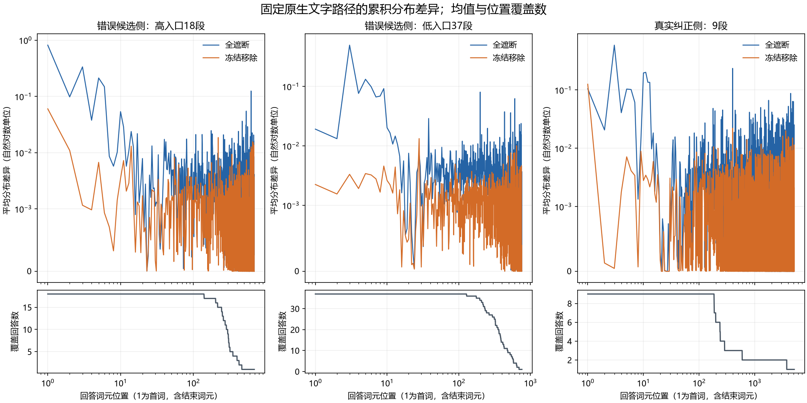

# 64段语义迁移固定文字分布轮廓

**64段均已完成，652次前向、零新生成。新分块与单词元调用的零编辑检查全部通过，最大差和第99百分位均为0。**

本报告只分析原有64条原生文字，在相同文字前缀下比较原生、全遮断、冻结移除的下一词元分布。操作从助手头起持续生效。它测累积影响，不证明正文所在位置仍在直接读取旧句，不是新768条自由回答的行为结果，也不作推进门。

温度0.7，完整词表，无截尾；以原生为参照计算两个方向固定的相对熵。每段包括结束词元，按256词元分块，合计151块；共同前序192次、三臂分块453次、新调用形状检查7次。没有失败或重复重跑。

图的横轴为对数位置，纵轴用线性阈值0.001的对称对数刻度显示小值；作图将舍入产生的极小负数显示为0，数值文件保留原值。长位置的回答构成会变化，不能把尾部均值当成全体回答的持续效应。

## 位置窗口描述

每个窗口先在一条回答内取均值，再对有覆盖的历史等权平均。窗口只是固定位置范围，不冒充首句或事实承诺边界。

|材料|窗口|有覆盖历史|全遮断平均差异|冻结移除平均差异|
|---|---|---:|---:|---:|
|错误候选侧：高入口18段|首词|18|0.813905|0.0600042|
|错误候选侧：高入口18段|第2—16词元|18|0.0660643|0.0035826|
|错误候选侧：高入口18段|第17—64词元|18|0.00484234|0.00148425|
|错误候选侧：高入口18段|第65—256词元|18|0.00396116|0.00154508|
|错误候选侧：高入口18段|第257词元以后|13|0.0038081|0.0010113|
|错误候选侧：低入口37段|首词|37|0.0190573|0.00223494|
|错误候选侧：低入口37段|第2—16词元|37|0.074526|0.00239973|
|错误候选侧：低入口37段|第17—64词元|37|0.00405551|0.00138131|
|错误候选侧：低入口37段|第65—256词元|37|0.00462218|0.0013864|
|错误候选侧：低入口37段|第257词元以后|28|0.00376772|0.00120448|
|真实纠正侧：9段|首词|9|0.104686|0.125168|
|真实纠正侧：9段|第2—16词元|9|0.10818|0.00315626|
|真实纠正侧：9段|第17—64词元|9|0.00252933|0.000735101|
|真实纠正侧：9段|第65—256词元|9|0.0043732|0.00145425|
|真实纠正侧：9段|第257词元以后|4|0.00447783|0.000920276|

## 单列真实纠正侧异常题

|历史|全遮断首词差异|冻结移除首词差异|全遮断全长均值|冻结移除全长均值|
|---|---:|---:|---:|---:|
|library-02-0|0.501033|0.326632|0.00814624|0.00194742|
|library-02-1|0.440513|0.798848|0.0100888|0.00493013|

逐历史概括、逐位置均值/中位数及覆盖数见同名JSON。完整逐位置实际词元对数概率仍在A100的本批 `profiles.json`；未据它选择内容归因目标。

后续768条使用独立的新抽样流，不按本轮廓筛历史、调方向、调整强度或决定样本量。正文行为需完成既定人工判读。
