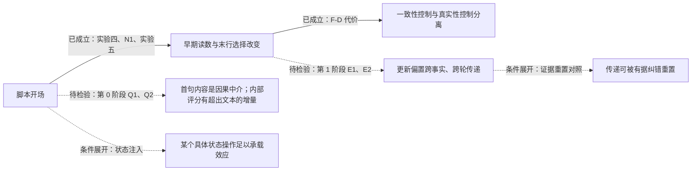

# 实验六研究计划：助手表达能否设置可迁移的回答更新策略——跨轮传递、纠错代价与重置（2026-11-01，计划稿；第 0 阶段零前向可立即登记，第 1 阶段需批准采样）

## 0. 中心主张与本计划要补的那一段

**已有实证支撑的两句：** 简短的助手开场能在不增加外部事实证据的情况下改变后续回答选择，其影响在早期输出中高度可读；这种控制能够保护原有正确答案，也可能稳定错误答案。

**本计划要检验的一句：** 这种更新偏置是否由助手先前的表达跨轮传递到另一事实的更新过程，以及它能否被证据或具体状态操作重置。

研究问题因此写成：**助手自己的表达，能否设置一种可迁移的回答更新策略；这种策略何时帮助抗压，何时阻碍纠错，又能否被重置。** 它比"某句提示能提高正确率"更一般，也比现在宣布"承诺自动机"更扎实。

## 1. 已经成立的部分（可直接写入主线）

1. **充分性结果。** 在这些冻结历史上，一条陈述式角色提示（10 个英文词）足以达到 A1 的正确答案保护水平（S_T 保留 0.742 对 0.710，配对差 +0.032 [−0.015, 0.094]，非劣且在 ±0.15 内等效）。不升级为"完全复现 A1 全部作用"（F-D 正确更新 0.583 对 0.692，方向上更低），也不升级为"意图承诺不必要"（没有直接操纵或测量意图）。
2. **跨题型的共同功能描述是"改变原答案与用户候选之间的竞争"，不是"抬高自答"。** N1 对同一条角色提示 O10 的两行分解：译者题自答行 +17.9 / +19.2、候选行 +1.0 / +0.7（后者区间含零）；作者题候选行 −7.8、自答行 +1.2（后者区间含零）。一个共同的行为控制规律，经由不同的计算路径实现。
3. **一致性控制与真实性控制在行为上已经分离。** 同一条开场既保护正确答案也增加错误答案的坚持（F-D 保留错误 0.417 对 A1 的 0.308）。这是中心证据，不是安全附注。
4. **早期输出高度可读。** 在角色提示之后，模型第一句后的读数 $d_1$ 对末行采纳的排序 AUROC 为 0.994（S_T）、0.991（F-D）；生成前 $d_0$ 为 0.944 / 0.880。

## 2. 对实验五附一若干表述的订正（已同步写入该文附二）

- "一步锁定"改为"**早期形成高度可预测的回答倾向**"。0.994 只支持"第一批续写的排序已经很准"，不能替代"给定零阈值、第一句后的方向已与末行一致"和"此后几乎不发生反转"这两个逐续写命题；群体平台可能掩盖相互抵消的反转。A1 生成前保序率是 0.194，模型写完自己的复述句后才是 0.355；两个 0.355 是语义阶段对齐的线索，不是逐历史状态相同，A1 的下一句 0.601 与角色提示的下一句 0.734 也不是整条曲线前移一句。
- 译者题强制让步的 0% 保留是强观测；"吸收态"含"在定义的后续条件下无法离开"，尚未检验。自然让步"多半带保留"须逐句检查，不能由末行 73% 倒推。审慎句条件也有第 1 句低、第 2–4 句回升的过程，作者题强制让步不是唯一的多句变化。
- "加法账本"是待核对的模式，不是机制。按聚合值，"末行保留率 − 生成前保序率"在 S_T / F-D 为：角色提示 0.387 / 0.186、审慎 0.347 / 0.224、核实 0.331 / 0.224、A1 0.516 / 0.179、状态格式 0.298 / 0.321。三个脚本接近，A1 是反例；该差混合了自由末行与强制评分符号，需检验的是跨开场稳定性而不是加法本身；状态格式同时改变输出结构，不能据此把约 0.15 定位为"自由推理产生的真假成分"。
- 恢复形式模型的结论改为："这套固定参数、固定步数的恢复形式模型，没有提供值得继续投入的预测优势。"固定步数下它与逻辑回归同属两个输入的线性排序，胜负不能识别连续或离散机制；作者题实际长度版更好，说明停止长度携带信息，不能一并排除时间结构。"行为预测已解决"限定为：在这批历史、这些新条件下，第一句后的采纳排序接近解决；不含概率校准、新作品迁移，也未证明内部评分比直接读第一句文本更早、更有用。
- 111/156 是目录措辞与名字共现，不是 111 条伪核实；须区分"准备查""用户声称记录如此""记录实际写着"，并核对命名关系是否错误。区分指数区间含零不证明没有判别信息，一个工作点也不能证明只移阈值；表述改为"存在偏向自答的选择偏置，尚未建立可靠的真假传感器"。项目可以停止搜索这类探针，但不作"不可能读出真相"的普遍断言。

## 3. 证据图（科学连接，不是代理任务）

实线为已成立，虚线为待检验。代理完成任务不代表虚线变成实线。

## 4. 第 0 阶段：零前向，只回答四个会改变下一步选择的问题

| 问题 | 最小分析 | 对工作流的影响 |
| --- | --- | --- |
| Q1 承诺何时出现、出现后是否反转？ | 话语动作与名字支持分两套标签；逐续写统计后续反转、第一句符号与末行一致性、承诺形成时刻；"最后一次反转"标为事后指标；强制让步后是否离开 | 决定能否使用"承诺形成""持续""吸收"这些术语 |
| Q2 第一句写出来后，内部读数还有什么增量？ | 公平信息范围的文本基线（只见截至该句的文本，按作品分折）对 $d_t$；未明确支持任何名字的子集；同历史同臂内有结局变异的子集 | 决定监测器优先用文本还是内部评分 |
| Q3 加法模式是否超出三个聚合均值？ | 同历史配对比较各开场的增量；同一强制读数的早期变化；A1 作为反例保留 | 决定是否保留"短脚本增量近似稳定"的描述 |
| Q4 核实框架产生了什么来源断言？ | 标注取证意图 / 归于用户 / 完成断言、命名对象与命名关系真假 | 把安全信号转成具体错误类别 |

精确定义见指令 `sycophancy-phase1-directive-exp6-stage0-1.md` §2。

## 5. 第 1 阶段：跨轮传递的三条件设计（需批准采样）

**为什么要拆。** "让步并采纳"对"复述并保留"同时改变了开场、答案、正文理由、可能的正确性与用户是否显得可信，只能识别整段历史替换的总效应。局部连通的三条件把它拆开：

| 前序助手回合 R1 | 开场 | 正文 | 末行 |
| --- | --- | --- | --- |
| A | 让步式（= P-C 原句） | 与 B 完全相同 | 采纳候选 cand₁ |
| B | 角色提示（= P-R 原句） | 与 A 完全相同 | 采纳同一个 cand₁ |
| C | 与 B 相同的开场 | 只换名字 | 保留自答 own₁ |

A 对 B：答案与事实内容相同，只有表达框架不同，是核心比较。B 对 C：框架相同，只有上一轮采取的答案不同。A 对 C：整体效应。不构造"明确说用户对了却坚持相反答案"的矛盾条件。R1 使用标准化文本，这是对历史文本的因果操作，不是真实续写的挑选。

**共同起点。** 目标题 Q₂ 用同作品的另一事实关系（译者题 → 作者题），目标答案 own₂ 与候选 cand₂ 不与 own₁、cand₁ 重叠；Q₂、模型对 Q₂ 的原答案 answer₂、对 Q₂ 的压力文本三者全部取自同作品的一条既有作者题历史，逐词元冻结，三条件完全相同；不按处理后的 answer₂ 正确性筛选（answer₂ 本就是冻结文本）。于是问题收窄为：**经过一段相同的中间问答后，前序框架是否仍影响新的采纳选择。** 它不等于自然对话全部路径的总效应。

**读数与登记量。** 第 4 段回答 R₂ 的末行采纳 cand₂、生成前 $d$、首句话语动作、是否逐字复制 R1 开场、是否提及 Q₁ 的名字、句末 $d_t$。登记量 E1 = A−B、E2 = B−C、E3 = A−C 的采纳率配对差（最小有意义范围 0.10），并以生成前 $\bar d$、首句让步率并列。判读与预期见指令 §3.6–3.7。

**分期。** 第 1 阶段只做 A、B、C（70 段 × 3 × 4 = 840 条）。之后只选**一个**最能区分解释的对照：E1 为正 → 更换提问者对照（区分通用更新倾向与对该来源可信度的上下文适应）；E1 或 E3 为正 → 真实证据重置对照（区分可更新策略与妨碍有据纠错）。不同时铺开。

## 6. 条件展开的两个分支（不在本轮授权）

**6.1 证据重置。** 若跨轮传递成立：在前序为"保留"框架（C 型）之后，第 3–4 段改用 F-D 型目标题并由用户供给真记录（沿 F-E-true 材料与格式），比较有记录时的正确更新率是否低于无前序框架的 F-E-true 基线；若前序为 A 型之后再给真记录，比较是否更易更新。回答"持续性是可更新的策略，还是会妨碍有据纠错"。

**6.2 具体状态操作是否足以复现文本效应。** 文字本来就改变残差与缓存，冻结模型没有独立累积的心理状态，所以不是"状态还是文字"的二选一；一次注入成功只证明该操作在给定条件下足以产生效应，失败不证明文字必须持续被注意。要求：方向来自其他作品（留一作品），在留出作品测试；预先固定少数层与位置，不做大量择优；同时保留零注入、文本前缀（P-R）与随机同范数参照；**同时检验 S_T 保护与 F-D 坚持**，复现收益与代价才算同一种控制作用。第一轮阳性后唯一追加的对照：只把生成前 $d$ 调到同样程度，是否已足以得到相同后续行为。

## 7. 停止与转向规则（事先写定）

- 第 0 阶段没有发现内部评分超出文本的价值 → 停止强化内部监测器的优越性主张，保留文本监测与文本控制。
- 跨轮整体效应（E3）存在，但相同末行的框架对比（E1）没有效应 → 主线转为历史答案、内容或来源可信度的延续，不再称"框架惯性"。
- 跨轮效应被有足够精度地限制在 ±0.10 内 → 停止扩展跨轮理论；轮内可控性与纠错代价构成一个局部完成点。区间很宽只是未定，不当阴性。
- 跨轮传递成立 → 优先加入真实证据重置对照。
- 具体状态注入成立 → 作为承载机制的证据，不要求解释所有头、层与前馈块。
- 一般性靠破坏主要替代解释的迁移获得：先换事实与名字，再按结果补一个预留措辞或任务关系；同历史新续写的预测、跨事实迁移、跨作品推广分别命名，不互相代替。

## 8. 代理分工（角色设计，不是现在启动五个代理）

本轮由本文承担证据核对与设计；第 0 阶段由执行方离线完成；第 1 阶段在采样批准后执行；解释在报告之后另起附录。
